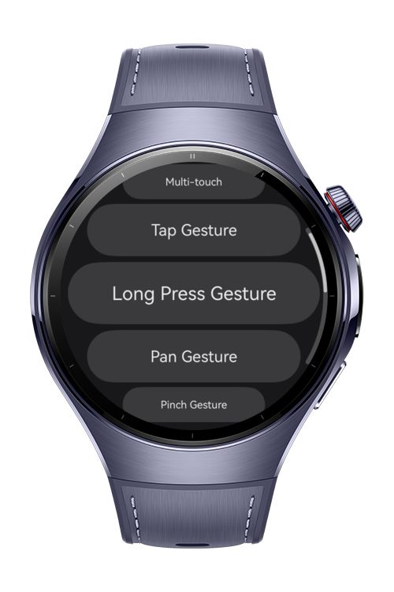
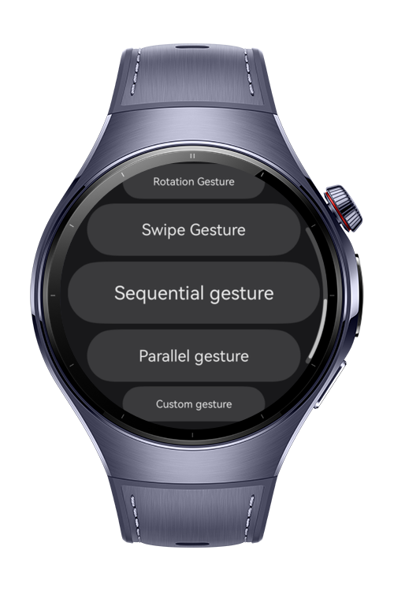
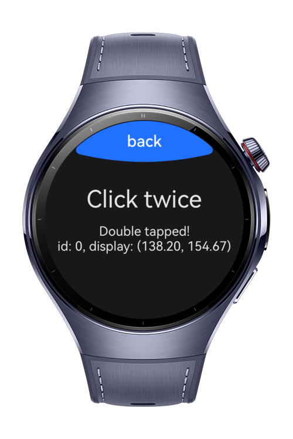
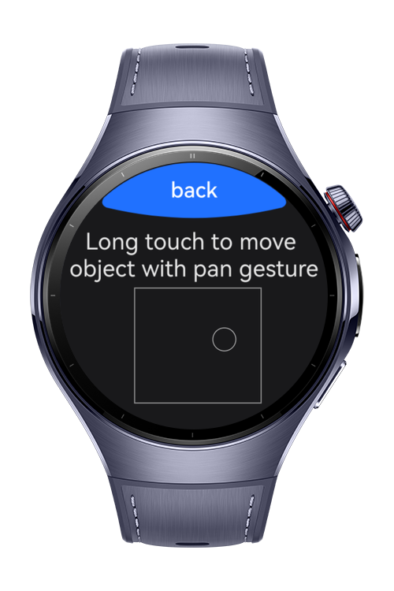

> **Note:** To access all shared projects, get information about environment setup, and view other guides, please visit [Explore-In-HMOS Index](https://github.com/Explore-In-HMOS/hmos-index).

# how-to-build-touch-gesture-lab-on-watch

The project is a compilation of different gesture examples such as tap, pan, pinch, and rotation. It also includes some examples of combined gestures, both sequential and parallel. 

# Preview
<div>
  
  
  
  
</div>

# Use Cases
- A multi-touch example
- Single gestures (tap, long press, pan, pinch, rotation, and swipe)
- Sequential and parallel gestures
- A custom gesture example

# Tech Stack
**Languages**: ArkTS, ArkUI
**Libraries/Kits**:
- @ohos.multimodalInput.touchEvent
- @ohos.multimodalInput.gestureEvent
- @kit.ArkUI

# Directory Structure
```
entry/src/main/
└───main
    │   module.json5
    ├───ets
    │   └───pages
    │           CustomGesturePage.ets
    │           Index.ets
    │           LongPressGesturePage.ets
    │           MultiTouchPage.ets
    │           PanGesturePage.ets
    │           ParallelCombinedGesturePage.ets
    │           PinchGesturePage.ets
    │           RotationGesturePage.ets
    │           SequentialCombinedGesturePage.ets
    │           SwipeGesturePage.ets
    │           TapGesturePage.ets
    │
    └───resources
        └───base
            └───profile
                    router_map.json
```

# Constraints and Restrictions
## Supported Devices
- Huawei Watch 5
- DevEco Studio Simulator

# LICENSE
**How to build touch gesture lab** is distributed under the terms of the **MIT License**.
See the [LICENSE](/LICENSE) for more information.